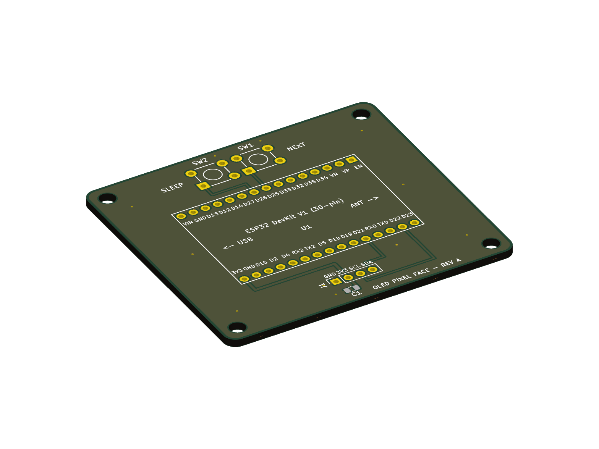
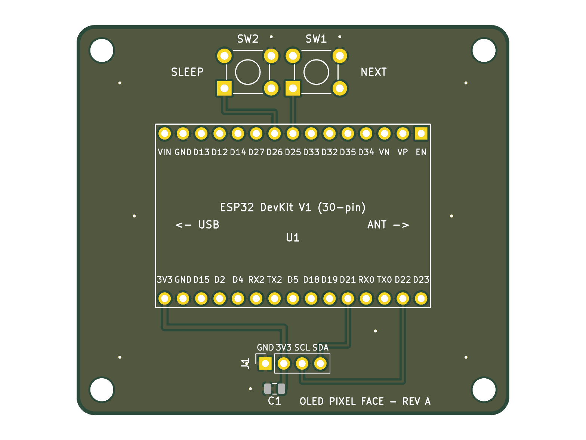
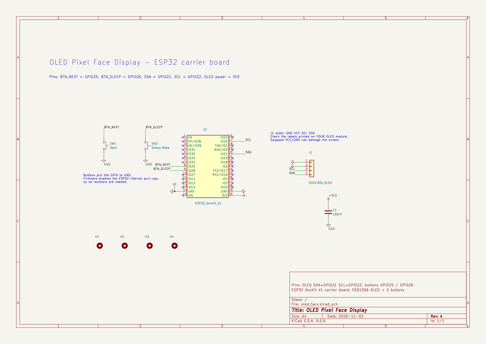

# OLED Pixel Face Display

A small ESP32 board that shows pixel-art faces on a 0.96" OLED screen. Two buttons change the face, put the screen to sleep, and turn on automatic mode, where the face changes by itself every 2.5 seconds.

## How it works

The ESP32 DevKit V1 talks to an SSD1306 OLED over I2C and draws each face from chunky pixel blocks. There are four faces: happy, surprised, sleepy and curious. The awake faces blink at random, and sleep mode shows a closed-eye face with floating "Zzz".

Both buttons connect a GPIO pin to ground, and the firmware turns on the ESP32's internal pull-ups, so no resistors are needed.

| Button | Short press | Hold about 0.7 s |
|---|---|---|
| Next (GPIO25) | Next face, turns automatic mode off | Previous face |
| Sleep (GPIO26) | Sleep or wake | Automatic mode on or off (while awake) |

## Why I made it

I first built this on a breadboard with loose jumper wires. I wanted it on one proper PCB so the screen, buttons and ESP32 are all in one piece and nothing can come loose.

## The PCB

A 60 x 54 mm two-layer carrier board. The ESP32 DevKit V1 (30-pin) plugs into two female headers, the OLED plugs into a 4-pin socket (GND, VCC, SCL, SDA), and the two buttons are on the board. The bottom layer is a ground plane. ERC and DRC in KiCad 9 both report zero violations.

### Pin map

| Function | ESP32 pin |
|---|---|
| OLED SDA | GPIO21 |
| OLED SCL | GPIO22 |
| OLED power | 3V3 |
| OLED ground | GND |
| Next button | GPIO25 |
| Sleep button | GPIO26 |

### Parts

| Part | Qty |
|---|---|
| ESP32 DevKit V1, 30-pin | 1 |
| 1x15 female header, 2.54 mm | 2 |
| 1x4 female header, 2.54 mm | 1 |
| 0.96" SSD1306 128x64 I2C OLED | 1 |
| 6x6 mm tactile switch, through-hole | 2 |
| 100 nF capacitor, 0805 (optional) | 1 |

## Files

- `hardware/` - KiCad 9 project (open `oled_face.kicad_pro`)
- `firmware/oled_face/oled_face.ino` - Arduino sketch
- `images/` - board renders and schematic

## Firmware

Open `firmware/oled_face/oled_face.ino` in the Arduino IDE, install the **Adafruit SSD1306** and **Adafruit GFX Library** libraries, select **ESP32 Dev Module**, and upload.

## Before you build

The board assumes 22.86 mm between the two rows of DevKit header pins, and an OLED module with pins in the order GND, VCC, SCL, SDA. Check both on your own parts first.
